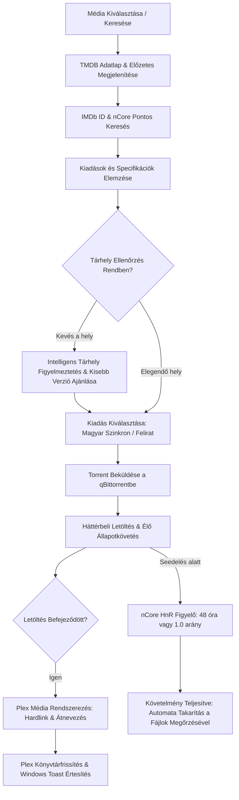

<div align="center">

# Ncore Plex Downloader

**Automatizált, egykattintásos média letöltő és rendszerező rendszer nCore, qBittorrent és Plex integrációval.**

[](https://python.org)
[](https://www.qbittorrent.org/)
[](https://www.plex.tv/)
[](https://www.themoviedb.org/)
[](tests/)
[](LICENSE)

<br>

<p align="center">
  <a href="#attekintes">Áttekintés</a> •
  <a href="#fobb-funkciok">Főbb Funkciók</a> •
  <a href="#munkafolyamat">Munkafolyamat</a> •
  <a href="#telepites-es-beallitas">Telepítés</a> •
  <a href="#hasznalat-es-inditas">Használat</a> •
  <a href="#tesztek">Tesztek</a> •
  <a href="#mappastruktura">Mappastruktúra</a>
</p>

</div>

---

## Áttekintés

A **Ncore Plex Downloader** célja, hogy a film- és sorozatkeresést végtelenül egyszerűvé, vizuálissá és tévedésmentessé tegye a család minden tagja számára. A felhasználó csupán kiválasztja a kívánt filmet vagy beírja a címét; a rendszer poszterekkel, leírással, előzetessel és stábbal azonosítja a tartalmat, majd a háttérben autonóm módon elvégzi a teljes letöltési, feliratozási, Hit & Run seedelési és Plex könyvtárfrissítési feladatot.

### Miért készült?

1. **Azonos címek és téves letöltések megelőzése:** Több azonos című vagy remake film esetén a puszta szöveges keresés gyakran téves kiadást tölt le. A TMDB vizuális megerősítés és a hivatalos IMDb azonosító (`tt...`) garantálja a 100%-os egyezést.
2. **Kiadások automatikus rangsorolása:** Automatikusan előnyben részesíti a legjobb minőségű magyar szinkronos kiadásokat (`hd_hun`, `sorozat_hun`), kiszűri a rossz minőségű kamerás felvételeket (CAM, TS), és ha csak eredeti nyelvű változat érhető el, automatikusan letölti és UTF-8-ra konvertálva illeszti a magyar feliratot.
3. **Plex azonnali elérés seedelés közben:** A Hardlink technológiának köszönhetően a film azonnal megjelenik a Plexben 0 MB extra tárhely-foglalás mellett, miközben a torrent kliens az nCore Hit & Run szabályoknak megfelelően (48 óra vagy 1.0 arány) tovább osztja a tartalmat.
4. **Többeszközös elérés a kanapéról:** PC-ről, okostelefonról vagy tabletről is közvetlenül használható helyi Wi-Fi-n keresztül, beépített azonnali QR-kóddal és Windows háttérszolgáltatással.

---

## Főbb Funkciók

| Terület | Funkcionalitás |
| :--- | :--- |
| **🌟 „Mit nézzünk ma este?”** | Kezdőlapi népszerű toplisták (TMDB Trending), Kritikuskedvencek és gyors műfaji szűrők (Akció, Vígjáték, Sci-Fi, Családi/Animáció, Krimi). |
| **🎯 Élő Minőség- & Nyelvjelvények** | A kártyákon azonnal látható: 🔊 Magyar 1080p/4K HDR, 🇬🇧 Eredeti hang + Felirat, ⏳ Mozis CAM figyelmeztetés vagy 🚫 Még nincs fent. |
| **📋 Részletes Specifikációk** | Minden kiadásnál felbontás (2160p 4K, 1080p, 720p), dinamikatartomány (Dolby Vision, HDR10+, SDR), hang (Dolby Atmos, DDP 5.1, DTS-HD MA), kodek és méret. |
| **🎬 „Nézz bele!” Trailer** | A részletek ablakban beágyazott YouTube videólejátszóval azonnal megnézhető a hivatalos magyar/eredeti előzetes. |
| **🎯 Intelligens Tárhelyvédelem** | Letöltés előtti lemezterület-ellenőrzés (+10 GB tartalék), barátságos figyelmeztetéssel és kompakt alternatíva választásával. |
| **📺 „Egygombos Teljes Évad”** | Sorozatoknál komplett évadcsomagok (`Pack`) vagy a teljes 1. évad letöltése egyetlen gombnyomással. |
| **⭐ Kívánságlista (Watchlist)** | Későbbre elmenthető filmek és sorozatok gyűjteménye perzisztens tárolással és azonnali letöltési lehetőséggel. |
| **🧹 Tárhely & HnR Statisztika** | Hardlinkkel megspórolt gigabájtok számlálója, élő seed idő követés (pl. `Seed: 31.5 / 48.0 óra`) és automata qBittorrent takarítás. |
| **⏰ Windows Autostart** | Egyetlen kapcsoló a Beállításokban: a gép indulásakor csendesen elindul a qBittorrent, a háttérfigyelő és a tálcaikon. |
| **🖥️ Windows Tálcaikon (Systray)** | Gyors elérés a tálcáról, hover tooltip élő letöltési sebességgel és százalékkal, jobb klikkes gyorsmenü. |
| **⚡ Önálló Háttérfolyamat** | 15 mp-es automatikus feldolgozó szál: böngésző nélkül is azonnal Plexbe rendezi a kész filmeket és natív Windows Toast értesítést küld. |
| **📱 Mobil QR-Kód** | Kamerával leolvasható QR-kód a telefonos / tabletes vezérléshez a helyi Wi-Fi hálózaton. |
| **🛠️ Rendszer Diagnosztika** | Beépített diagnosztikai fül élő logokkal, kapcsolat-ellenőrzésekkel és hibakereső funkciókkal. |

---

## Munkafolyamat

Az alábbi folyamatábra szemlélteti a rendszer belső automatizációját a kereséstől a TV-n való megjelenésig:



---

## Telepítés és Beállítás

### 1. Előfeltételek

- **Python**: 3.10 vagy újabb verzió
- **qBittorrent**: Web UI engedélyezve (*Eszközök ➡️ Beállítások ➡️ Web UI*)
- **Plex Media Server**: Helyi vagy távoli szerver (opcionális, de ajánlott)

### 2. Projekt letöltése

```bash
git clone https://github.com/Gyuri125/ncore-plex-downloader.git
cd ncore-plex-downloader
```

### 3. Virtuális környezet és függőségek

```bash
# Virtuális környezet létrehozása és aktiválása Windows alatt:
python -m venv .venv
.venv\Scripts\activate

# Csomagok telepítése:
pip install -r requirements.txt
```

### 4. Konfiguráció (.env)

Másold le a sablonfájlt `.env` néven:
```bash
copy .env.example .env
```

Nyisd meg a `.env` fájlt és töltsd ki a saját adataiddal (vagy állítsd be közvetlenül a webes felület `⚙️ Rendszer & Beállítások` fülén):

```env
# TMDB Beállítások (ingyenes regisztráció: https://www.themoviedb.org/settings/api)
TMDB_API_KEY=a_te_tmdb_api_kulcsod
TMDB_LANGUAGE=hu-HU

# nCore Hitelesítés
NCORE_USERNAME=felhasznaloneved
NCORE_PASSWORD=jelszavad
NCORE_PASSKEY=opcionalis_passkey

# qBittorrent WebUI Beállítások
TORRENT_CLIENT=qbittorrent
QBITTORRENT_HOST=http://localhost:8080
QBITTORRENT_USERNAME=admin
QBITTORRENT_PASSWORD=adminadmin

# nCore Hit & Run Szabályok
MIN_SEED_TIME_HOURS=48
TARGET_RATIO=1.0
AUTO_REMOVE_AFTER_SEED=true

# Mappák Útvonalai
DOWNLOAD_TEMP_DIR=C:/Torrents/Downloading
PLEX_MOVIES_DIR=C:/Media/Movies
PLEX_SERIES_DIR=C:/Media/TV Shows

# Plex Médiaszerver
PLEX_SERVER_URL=http://localhost:32400
PLEX_TOKEN=a_te_plex_tokened
AUTO_REFRESH_PLEX=true
```

---

## Használat és Indítás

### 1. Indítás az Asztalról (Egy kattintás)
- Az Asztalra kihelyezett **`Ncore_Media_Letolto.exe`** állományra duplán kattintva a háttérfigyelő, a qBittorrent és a tálcaikon azonnal elindul, majd megnyitja a webes felületet.
- **Forráskód módosítása esetén:** Futtasd a `python scripts/build_exe.py` parancsot, amely újrafordítja a friss forrást és felülírja az Asztalon lévő futtatható állományt.

### 2. Indítás parancssorból
```bash
python launcher.py
```
Vagy közvetlenül Streamlit módban:
```bash
streamlit run src/ui/app.py
```

### 3. Hálózati elérés (Mobil és Tablet)
Az alkalmazás elindítása után a helyi Wi-Fi hálózaton keresztül bármilyen eszközről megnyitható a felület fejlécében lévő QR-kód leolvasásával vagy a böngészőbe beírva:
```text
http://<SZÁMÍTÓGÉP_IP_CÍME>:8501
```

---

## Tesztek

A projekt átfogó automatizált egység- és integrációs tesztcsomaggal rendelkezik (**44/44 teszt sikeres**):

```bash
python -m pytest
```

Tesztelt modulok és folyamatok:
- Konfiguráció és típusvalidáció (`pydantic-settings`)
- Adatmodellek integritása és specifikáció-kinyerés (4K UHD, HDR, Dolby Atmos, kodekek)
- TMDB keresés, ajánlások (Trending, Top Rated, Műfajok) és előzetesek
- nCore HTML táblázat feldolgozás és minőségi pontozási algoritmus
- qBittorrent kapcsolat, torrent indítás és Hit & Run 48 órás szabályzat ellenőrzése
- Felirat kódolás javítás (CP1250 ➡️ UTF-8) és release név illesztés
- Plex fájlrendező (Hardlink, mintafájlok kizárása, minőségi címkék kinyerése)
- Lemezterület-ellenőrzés és tárhelyvédelem
- Kívánságlista (Watchlist) perzisztens kezelése
- Windows automatikus indítás (Autostart) indítópult-kezelő
- Sorozatok évadcsomag és teljes sorozat letöltési folyamata
- Windows tálcaikon és csendes háttérfolyamat (Worker daemon)

---

## Mappastruktúra

```text
ncore-plex-downloader/
├── .env.example              # Környezeti változók sablonja
├── .gitignore                # Biztonsági Git kizárások (jelszavak, sütik, build)
├── AGENTS.md                 # Részletes fejlesztői és AI irányelvek
├── README.md                 # Hivatalos projekt dokumentáció
├── requirements.txt          # Python csomagfüggőségek
├── run_app.bat               # Windows kötegelt indítófájl
├── launcher.py               # Asztali belépési pont, qBittorrent indító & tálcamenedzser
├── scripts/
│   └── build_exe.py          # Asztali EXE fordító és Asztalra másoló szkript
├── tests/                    # 44 darab automatizált teszt (pytest)
│   ├── test_components.py
│   ├── test_full_suite.py
│   ├── test_new_features.py
│   └── test_tray_and_worker.py
└── src/
    ├── config/               # Pydantic beállítások (.env validáció és mentés)
    ├── models/               # Adatmodellek (MediaItem, TorrentRelease, SubtitleItem)
    ├── services/             # Külső szolgáltatások: TMDB, nCore, qBittorrent, Felirat, Plex, Tálca
    ├── core/                 # Hardlink szervező, Watchlist, Autostart, Háttér Worker és Orkesztrátor
    └── ui/                   # Modern Streamlit webes felhasználói felület (mobilbarát)
```

---

## Biztonság és Adatvédelem

- A tároló **nem tartalmaz** és soha nem követ éles jelszavakat, sütiket vagy privát tokeneket.
- A `.gitignore` szigorúan kizár minden `.env*`, `data/`, log és cookie fájlt a Git verziókövetésből.

---

## Licenc

Ez a projekt az [MIT Licenc](LICENSE) feltételei szerint használható. Kizárólag oktatási és személyes otthoni archiválási célokat szolgál.
