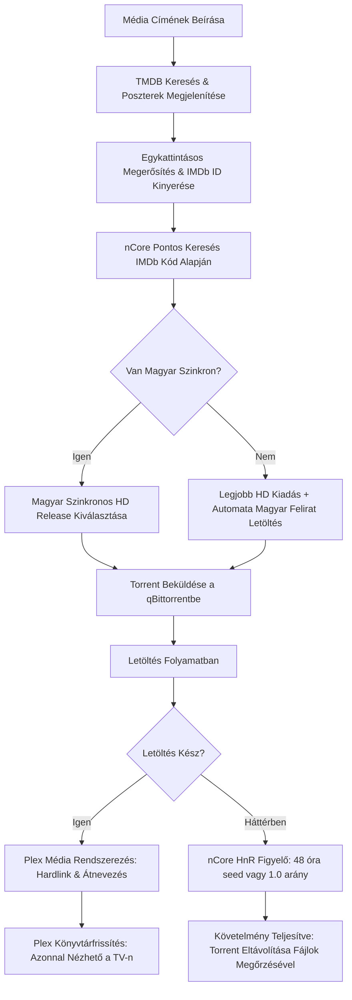

<div align="center">

# Ncore Plex Downloader

**Automatizált, egykattintásos média letöltő és rendszerező rendszer nCore, qBittorrent és Plex integrációval.**

[](https://python.org)
[](https://www.qbittorrent.org/)
[](https://www.plex.tv/)
[](https://www.themoviedb.org/)
[](tests/)
[](LICENSE)

<br>

<p align="center">
  <a href="#attekintes">Áttekintés</a> •
  <a href="#fobb-funkciok">Főbb Funkciók</a> •
  <a href="#munkafolyamat">Munkafolyamat</a> •
  <a href="#telepites-es-beallitas">Telepítés</a> •
  <a href="#hasznalat-es-inditas">Használat</a> •
  <a href="#tesztek">Tesztek</a> •
  <a href="#mappastruktura">Mappastruktúra</a>
</p>

</div>

---

## Áttekintés

A **Ncore Plex Downloader** célja, hogy a film- és sorozatkeresést végtelenül egyszerűvé és tévedésmentessé tegye. A felhasználónak csupán a média címét kell megadnia; a rendszer vizuálisan (poszterekkel, leírással, évszámmal és stábbal) azonosítja a kívánt tartalmat, majd a háttérben autonóm módon elvégzi a teljes letöltési, feliratozási, seedelési és Plex könyvtárfrissítési feladatot.

### Miért készült?

1. **Azonos címek problémája:** Több azonos című vagy remake film esetén a puszta szöveges keresés gyakran téves kiadást tölt le. A TMDB vizuális megerősítés és a hivatalos IMDb azonosító (`tt...`) garantálja a 100%-os egyezést.
2. **Kiadások rendezetlensége:** Automatikusan előnyben részesíti a legjobb minőségű magyar szinkronos kiadásokat (`hd_hun`), kiszűri a rossz minőségű felvételeket (CAM, TS), és ha csak eredeti nyelvű változat érhető el, automatikusan illeszti a magyar feliratot.
3. **Plex azonnali elérés seedelés közben:** A Hardlink technológiának köszönhetően a film azonnal megjelenik a Plexben 0 MB extra tárhely-foglalás mellett, miközben a torrent kliens az nCore szabályoknak megfelelően tovább osztja a tartalmat.

---

## Főbb Funkciók

| Terület | Funkcionalitás |
| :--- | :--- |
| **Vizuális Azonosítás** | TMDB API integráció magyar leírásokkal, poszterekkel, színészekkel, rendezőkkel és hivatalos IMDb azonosítóval. |
| **nCore Kereső & Rangsoroló** | IMDb kód alapú egyezés, szinkron prioritás (`hd_hun`, `sorozat_hun`), automata minőségi pontozás (BluRay, WEB-DL kiemelése, CAM kizárása). |
| **Automata Feliratkezelő** | Feliratok.info és OpenSubtitles keresőmotor, automata karakterkódolás konvertálás (CP1250 / ISO-8859-2 ➡️ tiszta UTF-8). |
| **Hit & Run Védelem** | qBittorrent WebUI vezérlés, 48 órás aktív seedelési idő vagy 1.0 arány elérése utáni automatikus leállítás a letöltött fájlok megőrzésével. |
| **Plex Rendszerezés** | Hivatalos Plex mappastruktúra és elnevezés (`Filmek/Cím (Év)/Cím (Év) [1080p].mkv`), Hardlink használat, azonnali Library Scan trigger. |
| **Többeszközös Felület** | Streamlit alapú reszponzív felület, amely helyi hálózaton keresztül PC-ről, telefonról és tabletről is kezelhető. |
| **Asztali Indító** | Önálló Windows futtatható állomány (`Ncore_Media_Letolto.exe`) és automata frissítő script (`build_desktop_exe.bat`). |

---

## Munkafolyamat

Az alábbi folyamatábra szemlélteti a rendszer belső automatizációját a kereséstől a TV-n való megjelenésig:



---

## Telepítés és Beállítás

### 1. Előfeltételek

- **Python**: 3.10 vagy újabb verzió
- **qBittorrent**: Web UI engedélyezve (*Eszközök ➡️ Beállítások ➡️ Web UI*)
- **Plex Media Server**: Helyi vagy távoli szerver (opcionális, de ajánlott)

### 2. Projekt letöltése

```bash
git clone https://github.com/Gyuri125/ncore-plex-downloader.git
cd ncore-plex-downloader
```

### 3. Virtuális környezet és függőségek

```bash
# Virtuális környezet létrehozása és aktiválása Windows alatt:
python -m venv .venv
.venv\Scripts\activate

# Csomagok telepítése:
pip install -r requirements.txt
```

### 4. Konfiguráció (.env)

Másold le a sablonfájlt `.env` néven:
```bash
copy .env.example .env
```

Nyisd meg a `.env` fájlt és töltsd ki a saját adataiddal:

```env
# TMDB Beállítások (ingyenes regisztráció: https://www.themoviedb.org/settings/api)
TMDB_API_KEY=a_te_tmdb_api_kulcsod
TMDB_LANGUAGE=hu-HU

# nCore Hitelesítés
NCORE_USERNAME=felhasznaloneved
NCORE_PASSWORD=jelszavad

# qBittorrent WebUI Beállítások
TORRENT_CLIENT=qbittorrent
QBITTORRENT_HOST=http://localhost:8080
QBITTORRENT_USERNAME=admin
QBITTORRENT_PASSWORD=adminadmin

# nCore Hit & Run Szabályok
MIN_SEED_TIME_HOURS=48
TARGET_RATIO=1.0
AUTO_REMOVE_AFTER_SEED=true

# Mappák Útvonalai
DOWNLOAD_TEMP_DIR=C:/Torrents/Downloading
PLEX_MOVIES_DIR=C:/Media/Movies
PLEX_SERIES_DIR=C:/Media/TV Shows

# Plex Médiaszerver
PLEX_SERVER_URL=http://localhost:32400
PLEX_TOKEN=a_te_plex_tokened
AUTO_REFRESH_PLEX=true
```

---

## Használat és Indítás

### 1. Indítás az Asztalról (Egy kattintás)
- Az Asztalra kihelyezett **`Ncore_Media_Letolto.exe`** állományra duplán kattintva a szerver a háttérben elindul, és automatikusan megnyitja a böngészőt.
- **Forráskód módosítása esetén:** Futtasd a **`build_desktop_exe.bat`** fájlt, amely újrafordítja a friss forrást és felülírja az Asztalon lévő futtatható állományt.

### 2. Indítás parancssorból
```bash
streamlit run src/ui/app.py
```
Vagy kattints a **`run_app.bat`** indítóra.

### 3. Hálózati elérés (Mobil és Tablet)
Az alkalmazás elindítása után a helyi Wi-Fi hálózaton keresztül bármilyen eszközről megnyitható a terminálban vagy a felület fejlécében jelzett címen:
```text
http://<SZÁMÍTÓGÉP_IP_CÍME>:8501
```

---

## Tesztek

A projekt átfogó automatizált egység- és integrációs tesztcsomaggal rendelkezik (30/30 teszt):

```bash
pytest tests/
```

Tesztelt komponensek:
- Konfiguráció és típusvalidáció
- Adatmodellek integritása
- TMDB keresés és IMDb ID kinyerés
- nCore HTML táblázat feldolgozás és minőségi rangsorolás
- qBittorrent kapcsolat és Hit & Run 48 órás szabályzat ellenőrzése
- Felirat kódolás javítás (CP1250 ➡️ UTF-8) és release név illesztés
- Plex fájlrendező (Hardlink, mintafájlok kizárása, minőségi címkék kinyerése)
- Plex könyvtárfrissítés API hívás
- Master orkesztrátor munkafolyamat

---

## Mappastruktúra

```text
ncore-plex-downloader/
├── .env.example              # Környezeti változók sablonja
├── .gitignore                # Git kizárások (jelszavak, cache, build)
├── AGENTS.md                 # Részletes fejlesztői és AI specifikáció
├── README.md                 # Hivatalos projekt dokumentáció
├── requirements.txt          # Python csomagfüggőségek
├── run_app.bat               # Windows kötegelt indítófájl
├── build_desktop_exe.bat     # Asztali EXE fordító és felülíró szkript
├── launcher.py               # Asztali belépési pont és böngésző indító
├── tests/                    # 30 darab automatizált teszt (pytest)
└── src/
    ├── config/               # Pydantic beállítások (.env betöltés)
    ├── models/               # Adatmodellek (MediaItem, TorrentRelease)
    ├── services/             # TMDB, nCore, qBittorrent, Felirat és Plex modulok
    ├── core/                 # Szervező (Hardlink) és folyamatvezérlő
    └── ui/                   # Streamlit webes felület
```

---

## Biztonság és Adatvédelem

- A tároló **nem tartalmaz** és nem követ jelszavakat, sütiket vagy privát tokeneket.
- A `.gitignore` megakadályozza a `.env` konfiguráció és a privát torrent állományok feltöltését.

---

## Licenc

Ez a projekt az [MIT Licenc](LICENSE) feltételei szerint használható. Kizárólag oktatási és személyes archiválási célokat szolgál.
