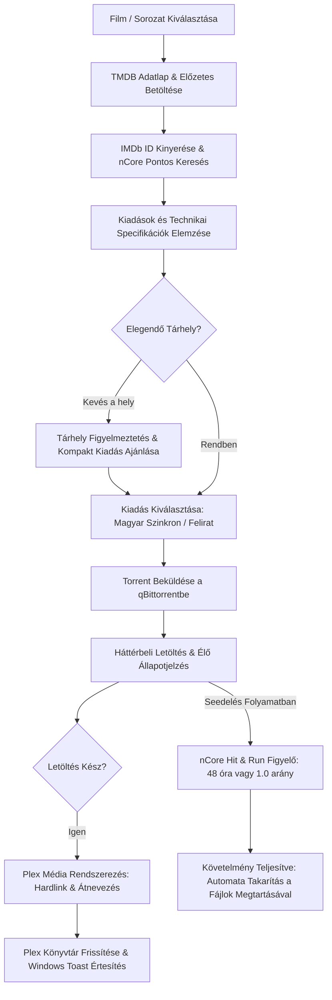

<div align="center">

# 🎬 Ncore Plex Downloader

**Automatizált, egykattintásos média letöltő és rendszerező rendszer nCore, qBittorrent és Plex integrációval.**

[](https://python.org)
[](https://microsoft.com/windows)
[](https://www.qbittorrent.org/)
[](https://www.plex.tv/)
[](https://www.themoviedb.org/)
[](tests/)
[](LICENSE)

<br>

> **Nem vagy informatikus? Nem baj!**
> Ezt a rendszert úgy terveztük, hogy egyetlen kattintással elindítható legyen a mellékelt `Inditas_Windows.bat` fájllal, és a család bármelyik tagja kényelmesen kezelhesse akár a kanapéról, mobiltelefonról is!

<br>

<p align="center">
  <a href="#-1-perces-gyors-inditas-barki-szamara"><b>🚀 1 Perces Gyors Indítás</b></a> •
  <a href="#-fobb-funkciok">Főbb Funkciók</a> •
  <a href="#-tmdb-api-kulcs-beszerzese-1-perc">TMDB API Kulcs</a> •
  <a href="#-qbittorrent-beallitasa">qBittorrent Beállítás</a> •
  <a href="#-mobil-es-tablet-hasznalat">Mobil Elérés</a> •
  <a href="#-munkafolyamat">Munkafolyamat</a> •
  <a href="#-gyakran-ismetelt-kerdesek-gyik">GYIK</a> •
  <a href="#-tesztek">Tesztek</a>
</p>

</div>

---

## 🚀 1 Perces Gyors Indítás (Bárki számára!)

Válassz az alábbi két indítási lehetőség közül:

### 🅰️ Opció: Letöltés & Indítás 1 Kattintással (Ajánlott nem-fejlesztőknek)

1. **Töltsd le a csomagot ZIP formátumban:**
   - Kattints a zöld **`<> Code`** gombra az oldal tetején, majd válaszd a **`Download ZIP`** lehetőséget (vagy töltsd le a legfrissebb kiadást a [Releases](../../releases) fülről).
2. **Csomagold ki:**
   - Húzd ki a ZIP tartalmát egy tetszőleges mappába (pl. `C:\Ncore_Downloader` vagy a `Dokumentumok` közé).
3. **Kattints duplán az `Inditas_Windows.bat` fájlra!**
   - 🪄 *Mit csinál ez automatikusan?*
     - Ellenőrzi a gépeden a Python-t.
     - Létrehozza a konfigurációs fájlt.
     - Felkészíti a szükséges csomagokat (csak az első indításkor tart ~1 percig).
     - Elindítja a csendes háttérfigyelőt, a qBittorrentet, kitűzi a tálcaikont az óra mellé, és **automatikusan megnyitja a gyönyörű webes felületet a böngésződben** (`http://localhost:8501`).
4. **Állítsd be a fiókjaidat a böngészőben:**
   - A megnyíló felületen menj a **`⚙️ Rendszer & Beállítások`** fülre.
   - Írd be az nCore felhasználóneved/jelszavad és az ingyenes TMDB API kulcsodat ([hogyan szerezz kulcsot? lásd lejjebb](#-tmdb-api-kulcs-beszerzese-1-perc)).
   - Kattints a **`💾 Beállítások Mentése`** gombra, és már kész is vagy!

---

### 🅱️ Opció: Fejlesztői Indítás (Git & CLI)

Ha szeretsz parancssorból dolgozni:

```bash
# 1. Tároló klónozása
git clone https://github.com/Gyuri125/ncore-plex-downloader.git
cd ncore-plex-downloader

# 2. Virtuális környezet létrehozása és aktiválása
python -m venv .venv
.venv\Scripts\activate

# 3. Függőségek telepítése
pip install -r requirements.txt

# 4. Konfigurációs fájl létrehozása
copy .env.example .env

# 5. Indítás (Tálcaikonnal, háttérfigyelővel és böngészővel)
python launcher.py
```

---

## 🔑 TMDB API Kulcs Beszerzése (1 perc, teljesen ingyenes)

A TMDB (The Movie Database) biztosítja a filmek és sorozatok magyar címeit, posztereit, leírásait, stáblistáját, előzeteseit és az IMDb azonosítókat.

1. Nyisd meg a [themoviedb.org/signup](https://www.themoviedb.org/signup) oldalt és regisztrálj ingyen (csak email cím és jelszó kell).
2. Lépj be, kattints a jobb felső sarokban a profilodra ➡️ **Beállítások** ➡️ bal oldali menüben az **[API](https://www.themoviedb.org/settings/api)** menüpontra.
3. Kattints a **„Létrehozás” (Create)** gombra, válaszd a **„Fejlesztő” (Developer)** opciót.
4. Fogadd el a feltételeket, és töltsd ki az űrlapot (Alkalmazás neve: pl. `Otthoni Plex`, Leírás: `Saját filmek rendszerezése`).
5. Az oldal generál egy **API kulcsot (`API Key - v3 auth`)**: másold ki, és illeszd be a letöltő felületének **Beállítások** menüjébe!

---

## ⚙️ qBittorrent Beállítása

A rendszer automatikusan észleli és elindítja a háttérben a qBittorrentet, de az első használat előtt ellenőrizd a WebUI bekapcsolását:

1. Nyisd meg a **qBittorrent** programot.
2. Menj a menüben: **Eszközök ➡️ Beállítások ➡️ Web UI** (vagy nyomj `Alt + O`-t).
3. **Pipáld be** a legfelső opciót: `Webes felhasználói felület (Web UI)`.
4. Ellenőrizd az adatokat:
   - **IP-cím:** `127.0.0.1` vagy `*`
   - **Port:** `8080`
   - **Felhasználónév:** `admin`
   - **Jelszó:** `adminadmin` *(vagy amit beállítasz, ugyanezt add meg az alkalmazás Beállításaiban is!)*
5. Kattints az **Alkalmaz** gombra.

---

## 📱 Mobil és Tablet Használat

Nem kell a számítógép előtt ülnöd a letöltéshez:

1. Csatlakozz a telefonoddal vagy tableteddel az otthoni Wi-Fi hálózatra.
2. A számítógépen futó felület fejlécében kattints a zöld **`📱 Mobil Elérés (QR-kód)`** gombra.
3. Olvasd le a telefonod kamerájával a képernyőn megjelenő QR-kódot!
4. **💡 Tipp:** A böngésződben válaszd a *„Hozzáadás a kezdőképernyőhöz”* (Add to Home screen) funkciót, így a telefonodon úgy fog működni, mint egy valódi natív mobilalkalmazás!

---

## ✨ Főbb Funkciók

| Terület | Képesség & Leírás |
| :--- | :--- |
| **🌟 „Mit nézzünk ma este?”** | Kezdőlapi dinamikus ajánlók: heti legnépszerűbb filmek & sorozatok (TMDB Trending), Kritikuskedvencek és gyors műfaji szűrők (Akció, Vígjáték, Sci-Fi, Animáció/Családi, Krimi). |
| **🎯 Élő Kiadás-Jelvények** | A kártyákon azonnal látható: 🔊 Magyar 1080p / 4K HDR, 🇬🇧 Eredeti hang + Felirat, ⏳ Mozis CAM figyelmeztetés vagy 🚫 Még nincs fent nCore-on. |
| **📋 Részletes Specifikációk** | Kiadások szerinti felbontás (2160p 4K UHD, 1080p FHD), dinamika (Dolby Vision, HDR10+, SDR), prémium hangszabványok (Dolby Atmos, TrueHD, DDP 5.1, DTS-HD MA), kodek és méret. |
| **🎬 „Nézz bele!” Trailer** | A részletek felugró ablakban beágyazott lejátszóval egy kattintással megtekinthető a hivatalos magyar vagy eredeti YouTube előzetes. |
| **🛡️ Intelligens Tárhelyvédelem** | Letöltés előtti automatikus lemezterület-ellenőrzés (+10 GB biztonsági tartalékkal), alacsony tárhely esetén barátságos figyelmeztetéssel és kompakt alternatíva választásával. |
| **📺 „Egygombos Teljes Évad”** | Sorozatoknál komplett évadcsomagok (`Pack`) vagy a teljes 1. évad összes részének letöltése egyetlen gombnyomással. |
| **⭐ Kívánságlista (Watchlist)** | Későbbre elmenthető filmek és sorozatok perzisztens gyűjteménye azonnali letöltési gombokkal. |
| **🧹 Hardlink & HnR Statisztika** | Hardlinkkel megspórolt gigabájtok kijelzése (0 MB extra tárhely a seedelés alatt!), élő nCore seed idő követés (`Seed: 32.5 / 48.0 óra`) és automata qBittorrent takarítás. |
| **🖥️ Windows Tálcaikon (Systray)** | Diszkrét ikon az óra mellett; rámutatva élőben mutatja a folyamatban lévő letöltések számát, sebességét és százalékát; jobb klikkes gyorsmenüvel. |
| **⚡ Önálló Háttérfolyamat** | 15 mp-es automatikus feldolgozó szál: a böngésző bezárása után is a háttérben figyeli a letöltéseket, azonnal Plexbe rendezi a kész filmeket és natív Windows Toast értesítést küld. |
| **⏰ Windows Autostart** | Egyetlen kapcsoló a Beállításokban: a gép bekapcsolásakor csendesen elindul a qBittorrent, a háttérfigyelő és a tálcaikon. |
| **🛠️ Diagnosztika & Hibakeresés** | Rendszer-ellenőrző fül élő naplókkal, kapcsolat-tesztekkel és részletes állapotinformációkkal. |

---

## 🔄 Munkafolyamat

Az alábbi ábra bemutatja, hogyan dolgozik a rendszer a háttérben helyetted:



---

## 📦 Saját Hordozható ZIP Csomag Készítése

Ha barátodnak, családtagodnak szeretnél küldeni egy előkészített, tiszta ZIP archívumot, a projekt tartalmaz egy beépített automata csomagolót:

```bash
python scripts/package_release.py
```

Ez a parancs a `dist/` mappába legenerálja a `Ncore_Plex_Downloader_v1.0_Windows_Portable.zip` fájlt, ami tartalmazza az összes szükséges forráskódot, a gyorsindító `Inditas_Windows.bat`-ot és a szöveges útmutatót, kizárva minden privát adatot (`.env`, jelszavak, sütik).

---

## ❓ Gyakran Ismételt Kérdések (GYIK)

<details>
<summary><b>1. Miért jobb ez, mint kézzel letölteni az nCore-ról?</b></summary>
Nem kell belépkedned a böngészőben, nem kell bogarásznod a torrent listákat, nem tölthetsz le téves azonos című filmet (mert az IMDb ID alapján keres), és ami a legfontosabb: a letöltés után nem kell kézzel átnevezned a fájlokat, nem kell feliratot keresned, és nem kell a Plex mappákba másolnod. A rendszer mindent elvégez helyetted.
</details>

<details>
<summary><b>2. Mi az a Hardlink és miért zseniális?</b></summary>
Amikor egy film letöltődik, a torrent kliensnek seedelnie kell azt 48 órán keresztül a Hit&Run szabályok miatt. Hagyományos másolásnál kétszer akkora helyet foglalna a lemezen (pl. 15 GB letöltés + 15 GB a Plex mappában = 30 GB). A <b>Hardlink technológiának</b> köszönhetően a fájl azonnal megjelenik a Plexben, lejátszható a TV-n, miközben a torrent kliens az eredeti helyén seedeli – <b>0 MB plusz tárhely használatával!</b>
</details>

<details>
<summary><b>3. Törlődnek a filmjeim a Hit&Run lejárta után?</b></summary>
<b>Nem!</b> Amikor a 48 óra aktív seedelés vagy az 1.0 feltöltési arány teljesül, a program kizárólag a qBittorrentből távolítja el a torrentet a lista tisztán tartása végett. A letöltött videofájlok épségben megmaradnak a merevlemezeden és a Plex könyvtáradban!
</details>

<details>
<summary><b>4. Futnia kell a böngészőnek a letöltések feldolgozásához?</b></summary>
<b>Nem.</b> A programhoz tartozik egy csendes háttérszál (Worker), amely 15 másodpercenként ellenőrzi a letöltések állapotát. Nyugodtan bezárhatod a böngészőt; amint kész a film, a háttérben átkerül a Plexbe és egy natív Windows értesítés ugrik fel az óra felett.
</details>

<details>
<summary><b>5. Mit tegyek, ha nem indul el a felület?</b></summary>
1. Ellenőrizd, hogy a Python telepítve van-e a gépeden (nyiss egy parancssort és írd be: `python --version`).<br>
2. Nyisd meg a webes felület `🛠️ Diagnosztika` fülét, vagy nézd meg a `logs/app.log` fájlt, ahol minden lépés részletesen nyomon követhető.
</details>

---

## 🧪 Tesztek

A kódbázis minőségét és stabilitását **44 darab automatizált egység- és integrációs teszt** garantálja:

```bash
python -m pytest
```

Főbb tesztelt területek:
- Pydantic beállítások és környezeti változók validációja
- Kiadás-specifikációk kinyerése (4K UHD, HDR, Dolby Atmos, méretek)
- TMDB keresés, toplisták és beágyazott előzetesek
- nCore HTML táblázat parzolás és minőségi pontozó algoritmus
- qBittorrent kapcsolatkezelés és Hit & Run 48 órás figyelés
- Felirat kódolás javítás (CP1250 ➡️ UTF-8) és release név illesztés
- Plex médiarendező (Hardlink, mintafájlok szűrése, felbontás kinyerés)
- Intelligens tárhelyvédelem és lemezterület-ellenőrzés
- Kívánságlista (Watchlist) perzisztens tárolása
- Sorozat évadcsomagok (`Pack`) feldolgozása
- Windows tálcaikon és önálló háttérfolyamat (Worker daemon)

---

## 📂 Mappastruktúra

```text
ncore-plex-downloader/
├── Inditas_Windows.bat       # 🚀 1 Kattintásos Gyorsindító Windowsra (Automata venv & felkészítés)
├── README_GYORSINDITAS.txt   # Rövid szöveges útmutató kicsomagolt ZIP-hez
├── launcher.py               # Fő belépési pont: qBittorrent indító, tálcaikon & háttérfolyamat
├── requirements.txt          # Python függőségek listája
├── .env.example              # Konfigurációs sablon (jelszavak nélkül)
├── .gitignore                # Biztonsági szabályzat: jelszavak, sütik és build mappák kizárása
├── build_desktop_exe.bat     # Asztali EXE fordító kötegfájl
├── scripts/
│   ├── build_exe.py          # PyInstaller EXE fordító szkript
│   └── package_release.py    # Terjeszthető, tiszta ZIP csomagoló szkript
├── tests/                    # 44 db automatizált pytest teszt
└── src/
    ├── config/               # Pydantic beállításkezelő (.env betöltés és mentés)
    ├── models/               # Adatmodellek (MediaItem, TorrentRelease, SubtitleItem)
    ├── services/             # TMDB, nCore, qBittorrent, Felirat, Plex és Tálca modulok
    ├── core/                 # Hardlink szervező, Watchlist, Autostart, Worker és Orkesztrátor
    └── ui/                   # Streamlit webes és mobilbarát felhasználói felület
```

---

## 🛡️ Biztonság és Adatvédelem

- A git tároló **soha nem tartalmaz** személyes hitelesítő adatokat, jelszavakat, sütiket vagy privát tokeneket.
- A konfigurációt a helyi `.env` fájl tárolja, amit a `.gitignore` szigorúan kizár a verziókövetésből.
- Az alkalmazás forráskódja 100%-ban nyílt, transzparens és helyben fut a gépeden.

---

## 📄 Licenc

A projekt az [MIT Licenc](LICENSE) feltételei szerint szabadon használható, módosítható és terjeszthető. Kizárólag személyes otthoni archiválási és oktatási célokat szolgál.
