# 🎬 Ncore Film & Sorozat Letöltő (Apa-barát Média Automatizáció)

[](https://python.org)
[](https://www.jetbrains.com/pycharm/)
[](https://www.qbittorrent.org/)
[](https://www.plex.tv/)
[](LICENSE)

Egy végtelenül egyszerű, felhasználóbarát („Apa-barát”) média letöltő és rendszerező alkalmazás Pythonban. Segítségével bárki könnyen kereshet filmeket és sorozatokat, a rendszer pedig a háttérben automatikusan megkeresi a legjobb minőségű kiadást nCore-on, gondoskodik a magyar szinkronról vagy feliratról, kezeli a seedelési szabályokat, és közvetlenül a Plex médiaszerverre készíti elő a tartalmat.

---

## 💡 Miért készült?

Sokszor előfordul, hogy egy filmnek több feldolgozása létezik azonos címmel, vagy a torrent oldalakon nehéz eligazodni a különböző kiadások (CAM, WEB-DL, szinkronos, angol) között.

Ez az alkalmazás megszünteti a tévedés lehetőségét:
1. **Vizuális azonosítás**: Beírt cím alapján megmutatja a lehetséges filmek borítóját, évszámát és leírását.
2. **Egy kattintásos megerősítés**: A felhasználó rábök arra a képre, amit tényleg látni szeretne.
3. **Automata háttérmunka**: A rendszer a háttérben IMDb azonosítóval megkeresi az nCore-on, letölti a legmegfelelőbb torrentet, letölti a magyar feliratot (ha nincs szinkron), betartja a seedelési kötelezettséget, átmozgatja a fájlokat és frissíti a Plexet.

---

## 🚀 Főbb Funkciók

- 🎯 **Tévedésmentes filmkeresés (TMDB integráció)**:
  - Poszterek, színészek, rendezők, magyar szinopszis és hivatalos IMDb azonosító lekérése.
- 🦁 **Intelligens nCore keresés**:
  - IMDb kód alapú pontos egyezés (nincs félreletöltés!).
  - **1. Prioritás**: Legjobb minőségű magyar szinkronos verzió (`hd_hun`, `sorozat_hun`).
  - **2. Prioritás**: Ha nincs szinkron, eredeti nyelves HD kiadás (`hd`, `sorozat`).
- 📝 **Automatikus Felirat Kereső Motor**:
  - Amennyiben csak angol/eredeti nyelvű kiadás érhető el, automatikusan megkeresi és letölti a hozzá illeszkedő magyar feliratot (OpenSubtitles / Feliratok.info), majd szabványos Plex formátumban mellékeli (`.hu.srt`).
- ⚡ **qBittorrent Automatizáció & Hit'n'Run Védelem**:
  - Automatikus torrent indítás és címkézés.
  - Figyeli az nCore HnR szabályzatát (pl. 48 óra seedelés vagy 1.0 arány elérése).
  - A szabály teljesülése után automatikusan megállítja/eltávolítja a feladatot a kliensből.
- 🍿 **Plex Rendszerezés & Automata Könyvtárfrissítés**:
  - Szabványos Plex mappastruktúrába (`/Filmek/Film Címe (Év)/...`) rendezi a letöltött fájlokat.
  - Plex API-n keresztül azonnal értesíti a szervert az új médiáról.
- 👨‍🦳 **Egyszerű, érthető kezelőfelület**:
  - Nagy méretű gombok, átlátható folyamatjelző, technikai zsargonoktól mentes dizájn.

---

## 🔄 Folyamat Ábra (Workflow)

```mermaid
sequenceDiagram
    autonumber
    actor Apa as Felhasználó (Apa)
    participant UI as Kereső Felület (WebUI)
    participant TMDB as Filmes Adatbázis (TMDB)
    participant nCore as nCore Kereső & Kliens
    participant Sub as Felirat Kereső
    participant Torrent as qBittorrent
    participant Plex as Plex Médiaszerver

    Apa->>UI: Beírja a film címét (pl. "Gladiátor")
    UI->>TMDB: Keresés magyar nyelven
    TMDB-->>UI: Találatok (Poszterek, Év, IMDb ID)
    UI-->>Apa: Képes lista megjelenítése
    Apa->>UI: Megerősítés: "Igen, ez az!"
    
    rect rgb(30, 40, 60)
        Note over UI,Plex: Automatikus Háttérfolyamat
        UI->>nCore: Keresés IMDb azonosító alapján
        alt Van Magyar Szinkronos HD
            nCore-->>Torrent: Letölti a magyar szinkronos torrentet
        else Csak Angol Nyelvű van
            nCore-->>Torrent: Letölti a legjobb angol kiadást
            UI->>Sub: Magyar felirat keresése a kiadáshoz
            Sub-->>Torrent: Felirat mentése (.hu.srt)
        end
        Torrent->>Torrent: Letöltés és nCore HnR seedelés (48 óra / 1.0 arány)
        Torrent-->>UI: Letöltés kész
        UI->>Plex: Fájl áthelyezése a Plex mappába + Könyvtárfrissítés
    end

    Plex-->>Apa: A film megjelent a TV-n és nézhető!
```



---

## 🛠️ Telepítés és Beállítás (PyCharm / Helyi környezet)

### 1. Projekt klónozása vagy GitHub beállítás
Ha GitHubra szeretnéd feltölteni a projektet:
```bash
git remote add origin https://github.com/FELHASZNALOD/ncore-plex-downloader.git
git branch -M main
git push -u origin main
```

Vagy klónozás:
```bash
git clone https://github.com/FELHASZNALOD/ncore-plex-downloader.git
cd ncore-plex-downloader
```

### 2. Python Virtuális Környezet (venv) létrehozása
PyCharmban:
- Nyisd meg a **Settings** -> **Project** -> **Python Interpreter** menüt.
- Hozz létre egy új virtuális környezetet (`.venv`, Python 3.10 vagy újabb).

Vagy parancssorból:
```bash
python -m venv .venv
# Windows esetén aktiválás:
.venv\Scripts\activate
```

### 3. Függőségek telepítése
```bash
pip install -r requirements.txt
```

### 4. Konfiguráció (`.env`) létrehozása
Másold le a `.env.example` fájlt `.env` néven:
```bash
copy .env.example .env
```
Töltsd ki a szükséges adatokat a `.env` fájlban:
- **TMDB_API_KEY**: Ingyenesen kérhető a [themoviedb.org](https://www.themoviedb.org/settings/api) oldalon.
- **NCORE_USERNAME / NCORE_PASSWORD**: nCore hozzáférésed.
- **QBITTORRENT_HOST / USERNAME / PASSWORD**: A qBittorrent Web UI bejelentkezési adatai.
- **PLEX_SERVER_URL / PLEX_TOKEN**: Plex médiaszerver elérhetősége.
- **PLEX_MOVIES_DIR / PLEX_SERIES_DIR**: A célmappák elérési útvonala.

---

## 🖥️ Használat és Indítás

### A) Asztali indítás (Egyetlen kattintás)
- Az Asztalra kihelyezett **`Apa_Media_Letolto.exe`** ikonra duplán kattintva az alkalmazás automatikusan elindul a háttérben, és azonnal megnyitja a böngészőt.
- **Kódfrissítés esetén:** Futtasd a **`build_desktop_exe.bat`** fájlt, ami újrafordítja a legfrissebb forráskódot és automatikusan felülírja az Asztalon lévő régebbi `.exe` fájlt!

### B) Indítás parancssorból vagy böngészőből
```bash
streamlit run src/ui/app.py
```
Vagy dupla kattintás a **`run_app.bat`** fájlra.
Ezután nyisd meg a böngészőben: `http://localhost:8501`.

### C) Mobil és Tablet elérés a helyi Wi-Fi-ről
Nyisd meg a telefon böngészőjében a felület fejlécében kiírt helyi címet (pl. `http://192.168.1.X:8501`), és Apa közvetlenül a telefonjáról is vezérelheti a letöltést!

---

## 🧪 Automata Tesztelés

A projekt átfogó tesztcsomaggal rendelkezik, amely mind a 9 fő modult ellenőrzi (30/30 sikeres teszt):
```bash
pytest tests/
```

---

## 📂 Mappastruktúra

```text
ncore-plex-downloader/
├── .env.example              # Konfigurációs sablon
├── .gitignore                # Git kizárások
├── AGENTS.md                 # Részletes kódolási és AI specifikáció
├── README.md                 # Ez a dokumentum
├── requirements.txt          # Python csomagfüggőségek
├── run_app.bat               # Windows duplakattintásos indító
├── build_desktop_exe.bat     # Asztali .exe készítő és automata felülíró
├── launcher.py               # Asztali böngészőindító belépési pont
├── tests/                    # Átfogó tesztcsomag (pytest)
└── src/
    ├── config/               # Pydantic beállítások (.env)
    ├── models/               # Adatstruktúrák (MediaItem, TorrentRelease)
    ├── services/             # TMDB, nCore, Felirat, qBittorrent és Plex modulok
    ├── core/                 # Szervező (Hardlink), orkesztrátor
    └── ui/                   # Streamlit Apa-barát felület
```

---

## 🔒 Biztonság és Adatvédelem

- A projekt **nem tartalmaz** és **nem tárol** jelszavakat vagy privát kulcsokat.
- A `.gitignore` gondoskodik róla, hogy a személyes `.env` fájlod és a letöltött torrent fájlok véletlenül se kerüljenek fel a GitHubra.

---

## 📜 Jogi Nyilatkozat

Ez a projekt kizárólag oktatási és személyes archiválási célokat szolgál. A felhasználó kizárólagos felelőssége a szerzői jogi szabályok és a felhasznált szolgáltatások (nCore, TMDB, Plex) felhasználási feltételeinek betartása.
