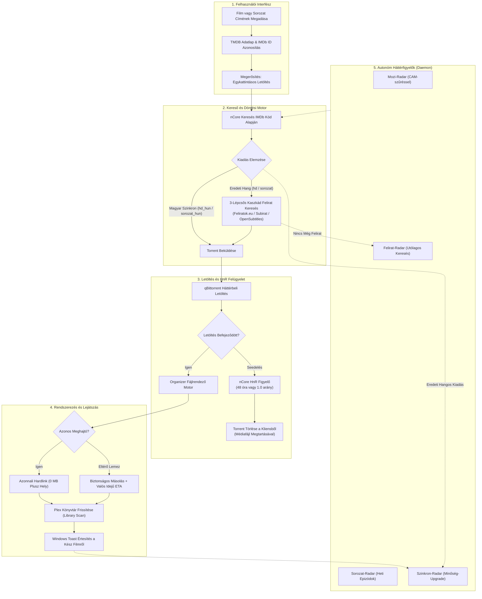

<div align="center">

# Ncore Film & Sorozat Letolto

**Automatizalt, egykattintasos media letolto es rendszerezo rendszer nCore, qBittorrent es Plex integracioval.**

[](https://python.org)
[](https://microsoft.com/windows)
[](https://www.qbittorrent.org/)
[](https://www.plex.tv/)
[](https://www.themoviedb.org/)
[](tests/)
[](LICENSE)

<br>

> **Otthoni felhasznalasra tervezve:**  
> A rendszer egyetlen kattintassal indithato a mellekelt `Inditas_Windows.bat` vagy `TELEPITO_ES_INDITO.bat` allomannyal. A csalad barmely tagja egyszeruen kezelheti szamitogeprol vagy a helyi Wi-Fi-re csatlakozva mobiltelefonrol, tabletrol is.

<br>

<p align="center">
  <a href="#1-gyors-inditas-es-telepites"><b>Gyors Inditas</b></a> |
  <a href="#2-rendszerarchitektura-es-munkafolyamat">Munkafolyamat</a> |
  <a href="#3-fobb-funkciok-es-kepessegek">Fobb Funkciok</a> |
  <a href="#4-beallitasok-es-fiokok">Beallitasok</a> |
  <a href="#5-mellekelt-szkriptek-es-inditofajlok">Inditofajlok</a> |
  <a href="#6-tesztek-es-stabilitas">Tesztek</a> |
  <a href="#7-gyakran-ismetelt-kerdesek-gyik">GYIK</a>
</p>

</div>

---

## 1. Gyors Inditas es Telepites

### A. Opció: Automatikus indítás egyetlen kattintással (Ajánlott)

1. **Csomag letöltése vagy kicsomagolása:**
   - Töltsd le a legfrissebb verziózott ZIP csomagot (`Ncore_Media_Letolto_v2.0.0.zip`), vagy klónozd a tárolót.
   - Csomagold ki egy tetszőleges mappába (például `C:\Ncore_Downloader` vagy a Dokumentumok mappába).
2. **Kattints duplán az `Inditas_Windows.bat` vagy `TELEPITO_ES_INDITO.bat` fájlra:**
   - A rendszer automatikusan ellenőrzi a gépen a Python környezetet.
   - Létrehozza a helyi virtuális környezetet (`.venv`) és telepíti a függőségeket.
   - Biztonságosan átörökíti a korábbi beállításokat (`%APPDATA%\NcoreMediaDownloader`).
   - Elindítja a qBittorrentet, a háttérfigyelő szolgáltatást, a rendszertálca ikont, és megnyitja a böngészőt (`http://localhost:8501`).
3. **Csendes háttérindítás fekete ablak nélkül:**
   - A `Csendes_Inditas.vbs` duplakattintással elindítja a programot úgy, hogy semmilyen zavaró fekete terminálablak nem marad nyitva a képernyőn; az alkalmazás diszkréten a háttérben fut az óra melletti tálcaikonnal.

---

### B. Opció: Fejlesztői indítás parancssorból (Git & CLI)

```bash
# 1. Tároló klónozása
git clone https://github.com/Gyuri125/ncore-plex-downloader.git
cd ncore-plex-downloader

# 2. Virtuális környezet létrehozása és aktiválása
python -m venv .venv
.venv\Scripts\activate

# 3. Függőségek telepítése
pip install -r requirements.txt

# 4. Konfiguráció előkészítése
copy .env.example .env

# 5. Indítás (Tálcaikon, háttérfolyamat és kezelőfelület)
python launcher.py
```

---

## 2. Rendszerarchitektúra és Munkafolyamat

Az alábbi folyamatábra szemlélteti, hogyan végzi el a rendszer teljesen önállóan a teljes média-előkészítési folyamatot a kereséstől a Plex könyvtár azonnali frissítéséig:



---

## 3. Főbb Funkciók és Képességek

| Terület | Funkció | Részletes Működés és Előnyök |
| :--- | :--- | :--- |
| **Keresés & Metaadatok** | **Elgépelés-biztos Intelligens Kereső** | Felismeri és javítja a gépelési hibákat (`oppenhejmmer` ➔ `Oppenheimer`). Feloldja a magyar számszavakat (`gladiator ketto` ➔ `Gladiátor II`, `dune masodik resz` ➔ `Dűne 2`). Ha egy összetett lekérdezésre nincs találat, lépésről lépésre tisztítja a szavakat (word-dropping fallback) a nulla találatos oldalak kizárására. |
| **Feliratkezelés** | **3-Lépcsős Kaszkád Felirat-Radar** | Automatikus feliratkeresés három független adatbázisból: **Feliratok.eu** (hazai scene release-ekhez igazítva), **Subirat.net** (legfrissebb mozis és streaming fordítások) és **OpenSubtitles REST API v3**. Szigorú évszám-kapuval (Year Gating) kizárja a más évjáratú filmek téves feliratait (pl. 2016-os Cousteau-film vs. 2026-os Odüsszeia). Automatikus CP1250/Latin-2 ➔ UTF-8 kódolásjavítás. |
| **Autonóm Figyelés** | **Szinkron-Radar & Minőség-Upgrade** | Ha egy premier film vagy új epizód először csak eredeti nyelven (magyar felirattal) vagy SD formátumban tölthető le, a rendszer elmenti a Plexbe, és a háttérben figyeli az nCore-t. Amint megjelenik a hivatalos magyar HD szinkron (`hd_hun` / `sorozat_hun`), automatikusan letölti, lecseréli az állományt a Plexben, és értesítést küld. |
| **Autonóm Figyelés** | **Mozi-Radar & CAM-Szűrő** | Még be nem mutatott vagy mozikban futó alkotások folyamatos háttérfigyelése. Szigorú CAM és Telesync (TS) szűrés: kizárólag valódi digitális kiadás (WEB-DL / BluRay) felbukkanásakor indítja el a letöltést. |
| **Autonóm Figyelés** | **Sorozat-Radar (Heti Epizód Követő)** | Futó heti sorozatok epizódjainak automatikus felkutatása és letöltése. Amint megjelenik a következő rész (pl. S02E05), a rendszer magától letölti, az évadmappába rendezi és frissíti a Plex könyvtárat. |
| **Tárhely & Fájlkezelés** | **Hardlink Technológia** | Azonos partíción (pl. `D:` letöltési mappa és `D:` Plex könyvtár) 0.001 másodperc alatt hoz létre fájlkapcsolatot: a tartalom azonnal lejátszható a TV-n, miközben a torrent seedelése változatlanul fut – **0 MB plusz tárhelyhasználattal**. |
| **Tárhely & Fájlkezelés** | **Valós Idejű Fájlmozgatási Folyamatjelző** | Különböző meghajtók közötti másoláskor folyamatos vizuális visszajelzést ad: forrás- és célútvonal, másolási sebesség (MB/s), hátralévő idő (ETA) és átvitt adatmennyiség (GB). |
| **Torrent Integráció** | **qBittorrent & HnR Védelem** | nCore szabályzat betartása: legalább 48 óra aktív seedelés vagy 1.0 feltöltési arány teljesülése után automatikusan eltávolítja a torrentet a kliensből, megelőzve a Hit & Run figyelmeztetéseket. A letöltött médiafájlok érintetlenül megmaradnak a Plex mappában. |
| **Torrent Integráció** | **Meglévő Torrentek Felismerése** | Képes felismerni a korábban, kézzel elindított vagy 350+ órája seedelt torrenteket is (`include_all=True`), importálja őket az adatbázisba, és egyetlen kattintással átrendezi őket a Plexbe (`Kényszerített Plexbe Áthelyezés`). |
| **Plex Integráció** | **Zero-Config Token & Frissítés** | Automatikus helyi token kinyerés a Windows Registry-ből vagy böngészős PIN-kódos belépés. Rendezés után azonnali könyvtárfrissítés (Library Scan triggerelése). |
| **Kezelőfelület** | **Mobil és Tablet QR-kódos Elérés** | A felület fejlécében elérhető egykattintásos QR-kód segítségével a telefon vagy tablet kamerájával pillanatok alatt csatlakozhatsz az otthoni Wi-Fi hálózaton keresztül. |
| **Rendszertálca & Daemon** | **Csendes Háttérfolyamat (Worker)** | 15 másodpercenként futó önálló szál, amely bezárt böngészőablak mellett is felügyeli a letöltéseket, elvégzi a Plex rendezést, és natív Windows Toast értesítést jelenít meg az óra felett. |
| **Hibatűrés & Biztonság** | **Öngyógyító JSON Tárhely** | Atomikus írás (`.tmp` ➔ `.bak` ➔ `os.replace`), áramszünet vagy sérült fájl esetén észrevétlen helyreállítás a biztonsági másolatból. Hálózati mikroszakadások ellen háromszoros HTTP Transport újrapróbálkozási stratégia. |

---

## 4. Beállítások és Fiókok

A rendszer konfigurálása elvégezhető közvetlenül a webes felület **Rendszer & Beállítások** menüpontjában, vagy a helyi `.env` fájl szerkesztésével.

### A. nCore Belépési Adatok
Add meg az nCore felhasználónevedet és jelszavadat a beállításokban. A rendszer titkosítva kezeli a belépést, és a jelszavad soha nem kerül ki a gépedről.

### B. TMDB API Kulcs (1 perc alatt, teljesen ingyenes)
A filmek és sorozatok magyar címeit, posztereit, leírásait, szereplőit és a pontos IMDb kódokat a TMDB (The Movie Database) biztosítja:
1. Nyisd meg a [themoviedb.org/signup](https://www.themoviedb.org/signup) oldalt és regisztrálj ingyenesen.
2. Lépj a profilodra a jobb felső sarokban: **Beállítások** ➔ bal oldali menüben az **API** menüpontra.
3. Kattints a **Létrehozás (Create)** gombra, válaszd a **Fejlesztő (Developer)** opciót.
4. Töltsd ki az űrlapot (Alkalmazás neve: pl. `Otthoni Média`, Leírás: `Saját filmek rendszerezése`).
5. Másold ki a generált **API Kulcsot (v3 auth)**, és illeszd be a letöltő felületének beállításaiba!

### C. qBittorrent WebUI Beállítása
A rendszer képes automatikusan elindítani a qBittorrentet a háttérben, de az első indítás előtt kapcsold be a WebUI felületet:
1. Nyisd meg a qBittorrentet, nyomj `Alt + O` billentyűkombinációt (vagy válaszd az **Eszközök ➔ Beállítások ➔ Web UI** menüt).
2. Pipáld be a **Webes felhasználói felület (Web UI)** lehetőséget.
3. Alapértelmezett beállítások:
   - **IP-cím:** `127.0.0.1`
   - **Port:** `8080`
   - **Felhasználónév:** `admin`
   - **Jelszó:** `adminadmin` *(vagy az általad megadott jelszó, amit a letöltő beállításaiban is megadsz).*
4. Kattints az **Alkalmaz** gombra.

### D. Plex Médiaszerver Kapcsolat
- Ha a Plex Media Server ugyanazon a Windows gépen fut, a rendszer automatikusan kinyeri a hitelesítési tokent a Windows Registry-ből.
- Ha másik gépen vagy NAS-on fut, a beállítások menüben a **Plex PIN Bejelentkezés** gombra kattintva böngészőn keresztül, 1 kattintással jóváhagyhatod a kapcsolatot.

---

## 5. Mellékelt Szkriptek és Indítófájlok

A projekt gyökerében és a `scripts/` mappában több előre elkészített segédeszköz található:

| Állomány | Feladat és Rendeltetés |
| :--- | :--- |
| `Inditas_Windows.bat` | Elsődleges gyorsindító Windowsra. Ellenőrzi a Pythont, aktiválja a virtuális környezetet, elindítja a háttérszálat, a tálcaikont és a webes felületet. |
| `TELEPITO_ES_INDITO.bat` | Teljes körű, egykattintásos telepítő és indító tiszta gépekre vagy új verziók kicsomagolásakor. |
| `Csendes_Inditas.vbs` | VBScript alapú csendes indító, amely elrejti a konzolablakot, így a program teljesen láthatatlanul fut a háttérben. |
| `Inditas.bat` | Alternatív közvetlen indító kötegfájl. |
| `launcher.py` | A rendszer központi vezérlője: ellenőrzi a qBittorrent futását, elindítja a tálcaikont (pystray), a háttérszálat (BackgroundWorker) és a Streamlit szervert. |
| `scripts/deploy_to_downloads.py` | Létrehozza a hivatalos verziózott telepítő ZIP csomagot a Letöltések mappában és a csatlakoztatott pendrive-on (`D:`). |
| `scripts/install.ps1` | PowerShell telepítő motor, amely automatikusan átörökíti a beállításokat a `%APPDATA%\NcoreMediaDownloader` mappából. |
| `scripts/get_plex_token.py` | Interaktív segédprogram a Plex hitelesítési token kinyerésére Windows Registry-ből vagy hivatalos Plex fiókból. |
| `scripts/package_release.py` | Publikus, személyes adatokat nem tartalmazó forráskód-csomagoló szkript. |
| `Frissits_Gemini_Argon.bat` | Automatizált Gemini AI export-generáló és szinkronizáló eszköz fejlesztőknek. |

---

## 6. Tesztek és Stabilitás

A rendszer megbízhatóságát és hibamentességét **121 darab automatizált egység- és integrációs teszt (100% zöld)** szavatolja.

A tesztek futtatása a projekt gyökeréből:

```bash
python -m pytest tests/
```

### Tesztelt területek:
- **Kereső és Metaadatok:** TMDB keresés, fuzzy matcher, magyar számszavak feloldása, elgépelés-korrekció, előzetesek és stáblisták.
- **nCore Scraper:** IMDb kódos keresés, kategória-prioritás, HTML táblázat parzolás, technikai specifikációk kinyerése.
- **Felirat Motor:** 3-lépcsős kaszkád kereső (Feliratok.eu, Subirat.net, OpenSubtitles v3), szigorú évszám- és típus-szűrés, CP1250 ➔ UTF-8 kódoláskonverzió.
- **Radarmotorok:** Mozi-Radar (CAM szűrés), Sorozat-Radar, Felirat-Radar és Szinkron-Radar életciklus tesztek.
- **Fájlrendező (Organizer):** Hardlink létrehozás, lemezek közötti valós idejű progress másolás, fájlzárolás-védelem, Plex mappastruktúra.
- **qBittorrent Kliens:** WebUI API kommunikáció, Circuit Breaker, 48 órás HnR felügyelet és automatikus tisztítás.
- **Plex Szolgáltatás:** Helyi token kinyerés a Windows Registry-ből, könyvtárfrissítés, aktív lejátszás alapú sebességkorlátozás.
- **Rendszer:** Atomikus mentés, `.bak` helyreállítás, Windows tálcaikon és önálló háttérfolyamat (Worker daemon).

---

## 7. Mappastruktúra

```text
ncore-plex-downloader/
├── Inditas_Windows.bat          # Elsődleges Windows gyorsindító kötegfájl
├── TELEPITO_ES_INDITO.bat       # Egykattintásos telepítő és indító
├── Csendes_Inditas.vbs          # Konzolablak nélküli csendes indító VBScript
├── launcher.py                  # Központi indító: tálcaikon, háttérszál, qBittorrent és WebUI
├── requirements.txt             # Szükséges Python csomagok jegyzéke
├── .env.example                 # Konfigurációs sablon (jelszavak nélkül)
├── .gitignore                   # Verziókövetési szabályzat: jelszavak, sütik és tokenek kizárása
├── README.md                    # Hivatalos projekt dokumentáció (ez a fájl)
├── README_TELEPITES.txt         # Egyszerű szöveges útmutató kicsomagolt verziókhoz
├── LICENSE                      # MIT licenc
├── scripts/
│   ├── install.ps1              # PowerShell telepítő és beállításmigrátor
│   ├── deploy_to_downloads.py   # Verziózott ZIP csomagoló és pendrive szinkronizáló
│   ├── get_plex_token.py        # Helyi Plex token kinyerő segédszkript
│   ├── generate_gemini_argon.py # Gemini AI export-motor
│   └── package_release.py       # Tiszta kiadás-csomagoló
├── tests/                       # 121 db automatizált pytest egység- és integrációs teszt
└── src/
    ├── config/                  # Pydantic Settings konfigurációkezelő (.env betöltés és validáció)
    ├── models/                  # Adatmodellek (MediaItem, TorrentRelease, SubtitleItem)
    ├── services/                # Külső szolgáltatások: TMDB, nCore, qBittorrent, Felirat (3-lépcsős), Plex, Tálca
    ├── core/                    # Rendszerező (Hardlink), Atomikus mentés, Radarok (Mozi, Sorozat, Felirat, Szinkron), Worker, Orchestrator
    └── ui/                      # Webes és mobilbarát kezelőfelület (Streamlit)
```

---

## 8. Biztonság és Adatvédelem

- A git tároló **szigorúan és garantáltan kizár** minden személyes azonosítót, jelszót, sütit vagy privát tokent.
- A konfigurációt a helyi `.env` fájl és a `%APPDATA%\NcoreMediaDownloader` mappa tárolja, melyeket a `.gitignore` kizár a verziókövetésből.
- A program forráskódja 100%-ban nyílt, transzparens, és kizárólag a helyi számítógépeden fut.

---

## 9. Gyakran Ismételt Kérdések (GYIK)

<details>
<summary><b>1. Miért jobb ez, mint kézzel letölteni az nCore-ról?</b></summary>

A hagyományos módszerrel be kell lépned a böngészőben, ki kell keresned a torrentet, ellenőrizned kell a release-t, és könnyű mellényúlni az azonos című filmeknél. A letöltés után kézzel kell átnevezned a fájlokat a Plex szabványai szerint, külön feliratot kell vadásznod az interneten, konvertálnod kell az ékezeteket, és át kell másolnod a médiát a megfelelő mappákba. 

Ez a rendszer mindent egyetlen kattintásra rövidít: az IMDb kód garantálja a 100%-os egyezést, a háttérmotor automatikusan letölti a megfelelő feliratot, átnevezi a fájlokat, azonnal frissíti a Plexet, és a 48 órás Hit & Run szabály után tisztán tartja a gépedet.
</details>

<details>
<summary><b>2. Mi az a Hardlink és miért takarít meg rengeteg helyet?</b></summary>

Amikor letöltesz egy filmet, a Hit & Run szabályok miatt legalább 48 órán keresztül a gépen kell tartanod azt a letöltési mappában. Hagyományos másolásnál egy 15 GB-os film kétszer szerepelne a lemezen (15 GB letöltés + 15 GB a Plex mappában = 30 GB). 

A Hardlink technológia révén a fájl a másodperc törtrésze alatt megjelenik a Plex mappában, lejátszható a tévén, miközben a torrent kliens az eredeti helyén seedeli – **0 MB plusz tárhelyhasználattal**.
</details>

<details>
<summary><b>3. Törlődnek a filmjeim a 48 órás Hit & Run után?</b></summary>

**Nem.** A 48 órás aktív seedelés vagy az 1.0 arány elérésekor a program kizárólag a qBittorrent kliensből távolítja el a feladatot a lista tisztán tartása céljából. A Plex mappába rendezett filmfájlok és feliratok biztonságban, véglegesen a merevlemezeden maradnak.
</details>

<details>
<summary><b>4. Futnia kell a böngészőnek a háttérmunkákhoz?</b></summary>

**Nem.** A rendszerhez egy csendes háttérszál (Worker daemon) tartozik, amely 15 másodpercenként ellenőrzi a feladatokat. Nyugodtan bezárhatod a böngészőt: amint elkészül egy letöltés, a program a háttérben elrendezi a Plexbe, frissíti a könyvtárat, és egy natív Windows értesítést küld az óra felett.
</details>

<details>
<summary><b>5. Mi történik, ha egy új filmhez még nincs magyar szinkron vagy felirat?</b></summary>

Ha a film megjelenésekor még csak eredeti nyelven (angolul) érhető el, a rendszer automatikusan felveszi a **Szinkron-Radar** és a **Felirat-Radar** figyelőlistájára. A háttérfolyamat csendben ellenőrzi az adatbázisokat, és amint felbukkan a hivatalos magyar HD szinkron vagy egy fordító feltölti a pontos feliratot, automatikusan letölti és Plexbe illeszti.
</details>

---

## 10. Licenc

A projekt az [MIT Licenc](LICENSE) feltételei szerint szabadon használható, módosítható és terjeszthető. Kizárólag személyes otthoni archiválási és oktatási célokat szolgál.
